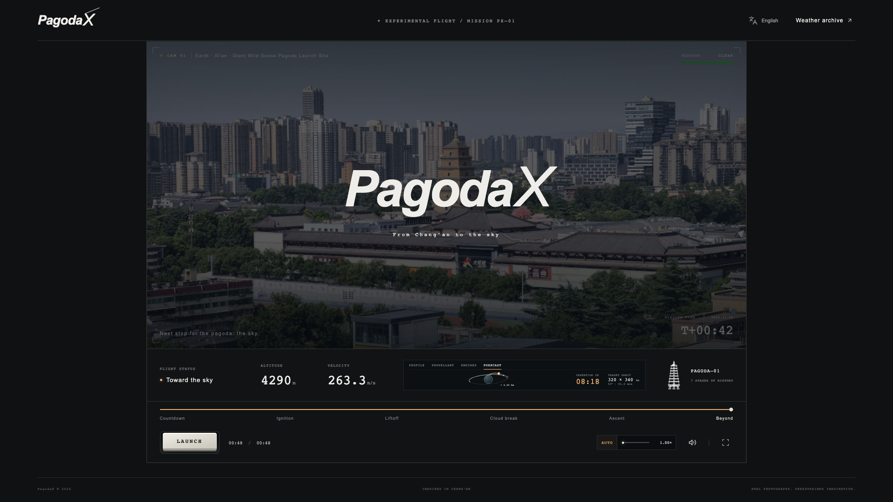
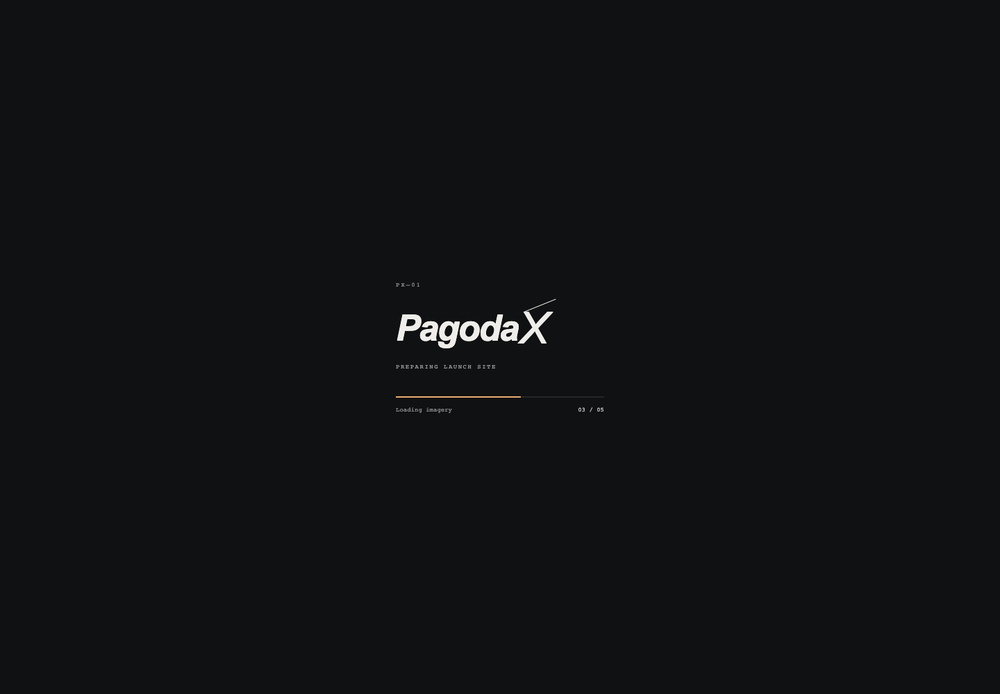

# PagodaX

English · [简体中文](README.zh-CN.md)

**An ancient pagoda. A new trajectory.**

A cinematic, interactive launch experience set in Xi’an. Real photography of the Giant Wild Goose Pagoda becomes the backdrop for a seven-stage spacecraft, nine engines, and a 48-second journey toward the sky.

[Experience PagodaX](https://szhjia.github.io/PagodaX/) · [Source and attribution](docs/references/SOURCES.md)



## The experience

- **Two linked cameras.** A fixed ground view and a 30-second ascent tracker share one scene and mission clock.
- **A tactile launch key.** LAUNCH stays pressed with a subtle amber text glow during the sequence and releases when the flight ends. Scrub the timeline or jump between mission phases.
- **Camera control.** Follow the automatic framing, or take over with 1–5× zoom and bounded drag-to-pan. Arrow keys pan the enlarged view.
- **Live instruments.** Switch between flight profile, propellant remaining, engine status, and a moving orbital forecast with a sliding transition. From liftoff, panels advance every three mission seconds and finish on the forecast. Manual selection remains available; pausing also pauses rotation.
- **Changing skies.** Haze gives way to clear air; the weather archive compares registered photographs with a draggable divider.
- **English and Simplified Chinese.** Switch in the header without restarting the flight. Language and mute preferences stay on your device.
- **A measured loading screen.** The opening screen follows four completed image loads and the first rendered scene. It stays visible for at least 1.5 seconds, then fades into the console over 600 ms once everything is ready. Reduced-motion preferences skip the fade.

The desktop console fits available viewport height while preserving the camera’s 1.95:1 aspect ratio. Smaller screens retain natural scrolling and a separate tracking view. Sound begins with the first launch gesture and can be muted.

<details>
<summary>Loading screen</summary>



</details>

## Run locally

Use Node.js 24 LTS and npm. No backend, API key, or environment file is required.

```sh
npm ci
npm run dev
```

Open the local URL printed by Vite. To preview the production output:

```sh
npm run build
npm run preview
```

## Deployment

The [Pages workflow](.github/workflows/pages.yml) runs unit tests and builds the site before publishing `dist/`. Pushes to `main` deploy automatically; it can also be run manually from GitHub Actions. In a fork, enable **Settings → Pages → Source → GitHub Actions**. Relative asset URLs support project subdirectories without hard-coding a repository name.

Only the five optimized runtime images are published. High-resolution originals, source artwork, local configuration and test output stay outside Git.

## Verification

```sh
npm test                 # Deterministic flight, camera, weather and orbit calculations
npm run test:e2e         # Browser interactions, layout, rendering, audio and loading
npm run build           # Production bundle
npm run test:deployment -- https://szhjia.github.io/PagodaX/
```

Browser checks use the project’s pinned Playwright package and an installed Google Chrome. They do not require a separate browser download. Set `PLAYWRIGHT_SKIP_BROWSER_DOWNLOAD=1` when installing dependencies if needed.

`npm run check:assets` is an additional local provenance check. It requires the original photographs in `data/`, which are deliberately excluded from the public repository. The public repository includes all assets needed to run, build and test the website.

## Static deployment

GitHub Actions tests and builds `main`, uploads **only `dist/`**, and deploys it to GitHub Pages. Enable **Settings → Pages → Source → GitHub Actions** when using a fork. See [the deployment workflow](.github/workflows/pages.yml).

The Vite base is relative, and runtime image URLs use the same base. The output can therefore be hosted at a domain root or a project subdirectory without changing source paths. Any static host that serves `dist/` can run the experience.

## Images and performance

Only five optimized WebP images ship with the website. Their combined size is **1.20 MiB**, down from **2.75 MiB** (56% smaller), with their original pixel dimensions preserved. The vehicle emblem uses lossless compression; photographic derivatives use WebP quality 82. Metadata is stripped. High-resolution originals, unused image studies, local editor configuration and historical screenshots are not deployed.

To regenerate the web images, place the source JPG/PNG files in the local, ignored `artwork-source/` directory and run:

```sh
sh scripts/optimize-images.sh
```

This optional authoring step uses `cwebp`; normal development and deployment use the committed WebP assets and do not require that tool. No original photograph is overwritten.

## How it works

| Location | Purpose |
| --- | --- |
| `src/flight.js` | One deterministic mission timeline for motion, readings and sound |
| `src/renderer.js`, `src/shaders.js` | Three.js rendering, photographic composition and lighting |
| `src/surfaces.js`, `src/tower.js` | Rectified photographic surfaces and seven-stage geometry |
| `src/camera-control.js` | Automatic framing, manual zoom and bounded panning |
| `src/forecast.js` | Current ascent position and planned future orbit |
| `src/weather-alignment.js` | Shared registration of clear and hazy imagery |
| `src/i18n.js` | English and Simplified Chinese copy |
| `public/assets/` | Optimized runtime images |
| `tests/` | Unit and browser regression tests |

The source imagery is registered against fixed buildings; the originals remain untouched. Tower surfaces use perspective-corrected photographs rather than a flat cutout. Both cameras render through a shared WebGL canvas.

## Creative context and credits

PagodaX is a science-fiction artwork. Flight telemetry, propellant figures, future orbit and visibility colors belong to its fictional mission; they are not live aerospace or air-quality measurements. Generated imagery supplies the haze study and the local background repair behind the departing pagoda. The runtime facade uses O.Mustafin’s CC0 photograph. Details and source links are in [SOURCES.md](docs/references/SOURCES.md).

The website uses [Three.js](https://threejs.org/) and [Vite](https://vite.dev/). Project-scoped development skills retain their upstream licenses and [provenance](.agents/skills/provenance.json). Third-party licenses apply to their respective materials; this repository does not grant additional rights to the project’s photography or artwork.
