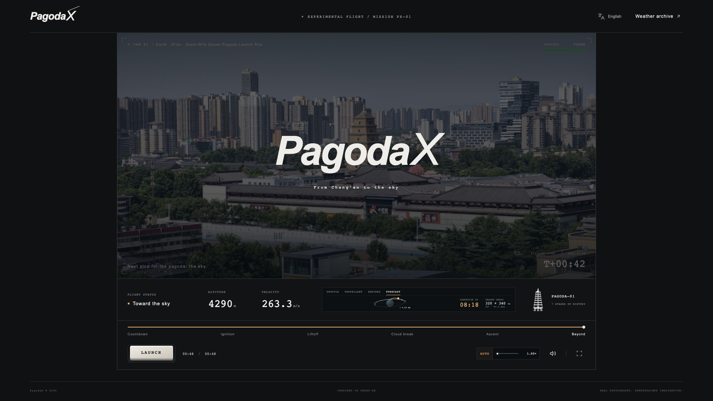
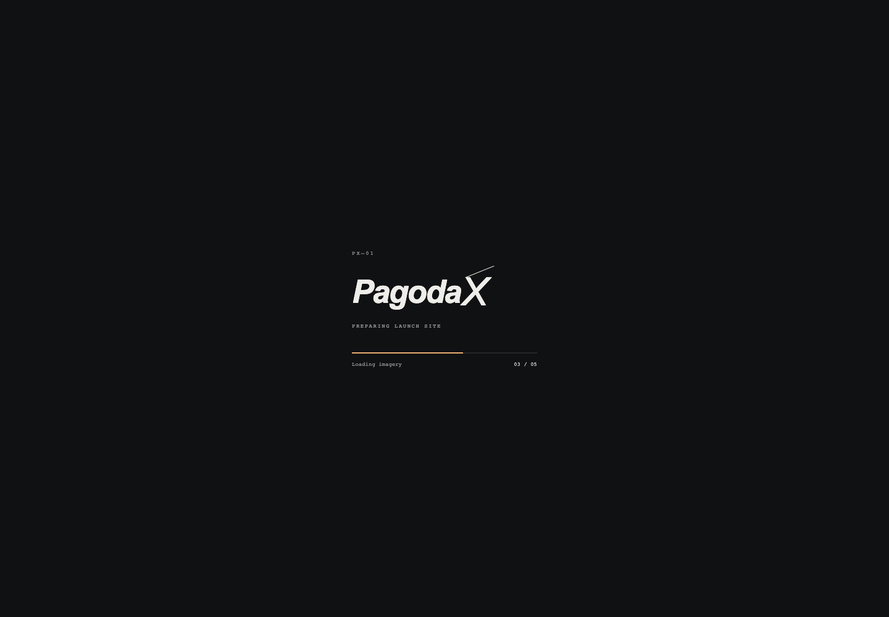

# PagodaX

[English](README.md) · 简体中文

**一座古塔，一次新的远行。**

以西安大雁塔的真实摄影为起点，让七层古塔成为九台引擎推动的飞行器，完成一场 48 秒的交互式发射。

[在线体验](https://szhjia.github.io/PagodaX/) · [影像来源与署名](docs/references/SOURCES.md)



## 体验

- **双镜头跟踪**：固定地面机位与持续 30 秒的升空跟踪，共享场景和任务时钟。
- **拟态发射键**：LAUNCH 按下后保持下陷，播放结束自动弹起。支持时间轴回拨与阶段跳转。
- **镜头控制**：默认自动构图；手动支持 1–5 倍变焦，放大后通过拖动或方向键平移，范围限制在照片边缘内。
- **四组仪表**：飞行剖面、推进剂余量、引擎状态、飞行预测，点击文字以横向推移切换。预测图显示当前爬升位置、已飞航段和未来轨道。
- **天气变化**：从重霾逐渐转为清晰；天气档案通过拖动分界线对比已配准的影像。
- **中英文切换**：界面默认英文，页眉可切换简体中文，不重置飞行；语言和静音选择保存在本机。
- **实际加载进度**：加载页统计四张场景影像和首帧渲染的完成状态，准备好后淡出并进入控制台。

桌面根据视口宽高适配整块控制台，保持摄像头 1.95:1 的比例。小屏保留自然滚动与独立跟踪画面。首次点击发射后启用声音，可随时静音。

<details>
<summary>加载页预览</summary>



</details>

## 本地运行

建议使用 Node.js 24 LTS 和 npm。不需要后端、API 密钥或环境变量文件。

```sh
npm ci
npm run dev
```

打开 Vite 输出的本地地址。生产构建与预览：

```sh
npm run build
npm run preview
```

## 部署

[Pages 工作流](.github/workflows/pages.yml) 先运行单元测试并构建，再发布 `dist/`。推送到 `main` 自动部署，也可从 GitHub Actions 手动触发。Fork 后，在 **Settings → Pages → Source** 中选择 **GitHub Actions**。资源采用相对路径，无须将仓库名写死。

发布产物仅含五张网页优化影像；高分辨率原图、素材源文件、本机配置和测试输出均不进入 Git。

## 验证

```sh
npm test
npm run test:e2e
npm run build
npm run test:deployment -- https://szhjia.github.io/PagodaX/
```

浏览器测试使用项目锁定的 Playwright 和已安装的 Google Chrome，无须重复下载浏览器。安装依赖时可设置 `PLAYWRIGHT_SKIP_BROWSER_DOWNLOAD=1`。

`npm run check:assets` 是额外的本地素材溯源检查，需要 `data/` 中的原始照片；原图不进入公开仓库。公开仓库已经包含运行、构建和测试网页所需的全部资源。

## 静态部署

推送到 `main` 后，GitHub Actions 自动运行单元测试和生产构建，仅上传 `dist/` 到 GitHub Pages。如果使用自己的分叉仓库，在 **Settings → Pages → Source** 中选择 **GitHub Actions**，部署配置见 [pages.yml](.github/workflows/pages.yml)。

Vite 和运行时图片共用相对基础路径，可部署到域名根目录或项目子目录。也可以将 `dist/` 发布到其他静态托管服务。

## 图片与加载

网页仅使用五张优化后的 WebP，总计 **1.20 MiB**，原先为 **2.75 MiB**，减少约 **56%**。像素尺寸与比例保持不变；飞行器标记无损压缩，摄影衍生图使用质量 82，移除元数据。

高分辨率原图、未使用的图像研究、本机编辑器配置和历史截图不进入发布产物。需要重新生成网页图片时，将 JPG/PNG 源文件放到本地忽略目录 `artwork-source/`，执行：

```sh
sh scripts/optimize-images.sh
```

这一可选素材制作步骤依赖 `cwebp`，正常开发与部署直接使用仓库内的 WebP，不需要该工具，也不会改写原图。

## 实现

| 位置 | 用途 |
| --- | --- |
| `src/flight.js` | 动画、遥测与声音共用的确定性任务时钟 |
| `src/renderer.js`、`src/shaders.js` | Three.js 渲染、实景合成与光照 |
| `src/surfaces.js`、`src/tower.js` | 实拍表面透视校正与七层几何 |
| `src/camera-control.js` | 自动构图、手动变焦与平移 |
| `src/forecast.js` | 当前爬升位置及后续轨道计划 |
| `src/weather-alignment.js` | 清晰与重霾影像共用的建筑配准 |
| `src/i18n.js` | 英文与简体中文文案 |
| `public/assets/` | 优化后的网页影像 |
| `tests/` | 单元与浏览器回归测试 |

照片按固定建筑配准，原始文件保持不变。塔体由独立三维几何决定轮廓，表面取自经过透视校正的实拍。两个镜头通过同一 WebGL 画布渲染。

## 创作与署名

PagodaX 是科幻创作。飞行读数、推进剂参数、未来轨道和天气色带属于任务设定，并非实时航天遥测或实测空气质量。生成影像用于重霾研究和原塔离开后的局部背景修复；运行时塔体立面使用 O.Mustafin 的 CC0 摄影，详见 [SOURCES.md](docs/references/SOURCES.md)。

工程使用 [Three.js](https://threejs.org/) 和 [Vite](https://vite.dev/)。项目内开发技能保留上游许可与[来源记录](.agents/skills/provenance.json)。第三方素材遵循各自许可；本仓库不额外授予项目摄影与艺术素材的使用权。
